Нативные инструменты для разработчика: Swift/SwiftUI на macOS, TypeScript и Python на бэкенде,
интеграции с LLM и агентами. Локально, быстро, без облака.

**Сейчас**

- [canvas_asx](https://github.com/ASXRND/canvas_asx) — канвас для macOS: терминалы, заметки, файлы на одной доске
- [filecommander](https://github.com/ASXRND/filecommander) — двухпанельный файловый менеджер с SSH/SFTP

**Стек** — Swift · SwiftUI / AppKit · SwiftPM · SwiftTerm + PTY · TypeScript / Node · Python · MCP / LLM

Связаться — issues в нужном репозитории.
